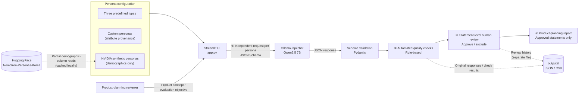

# AI Persona-Based Market Simulation & Response Validation

> A product-concept evaluation MVP that generates simulated consumer feedback using AI personas,
> applies automated quality checks and human review, and produces structured product-planning reports.


> [!IMPORTANT]
> **All consumer responses displayed by this application are simulated text generated by an AI model.**
> They are not responses from real consumers. The application does **not** measure or predict purchase rates, sales volume, or actual market preferences.
> Its outputs are intended to help identify **issues, hypotheses, and candidate questions** for subsequent consumer research.

---

## Table of Contents

1. [Project Overview](#project-overview) — Problems and approach
2. [Key Features](#key-features) — Implemented functionality
3. [System Architecture](#system-architecture) — Components and responsibilities
4. [Tech Stack](#tech-stack)
5. [Demo & Screenshots](#demo--screenshots)
6. [Validation Workflow](#validation-workflow) — Review process and results
7. [Limitations & Future Work](#limitations--future-work)
8. [Installation & Usage](#installation--usage)
9. [Data Sources & Acknowledgments](#data-sources--acknowledgments)

---

## Project Overview

This MVP was developed for the **LOTTE AX CHALLENGE** to support early-stage evaluation of new beverage concepts. It does not use actual company customer or sales data; the inputs and outputs are based on hypothetical product concepts and synthetic personas.

> **Core idea**
>
> 1. **Cost of consumer research:** Conducting surveys or focus group interviews for every early-stage product concept is costly and time-consuming.
> 2. **Reliability of AI personas:** AI-generated feedback is fast to obtain but cannot be accepted at face value.
> 3. **Automated checks and human review:** Rule-based checks flag potential problems, and a reviewer approves or excludes individual statements.
> 4. **Product-planning support:** Only approved statements are used to organize a planning report and candidate questions for future consumer research.

### Problem Definition

| # | Problem | Description |
|---|---|---|
| 1 | Difficulty screening early concepts from a consumer perspective | Product teams may consider many concepts in the early stages. Applying surveys or focus group interviews (FGIs) to every candidate requires substantial time and resources. |
| 2 | AI-generated consumer feedback is not inherently reliable | LLMs can invent features not specified in the product input, make unsupported health claims, or respond from a seller's perspective rather than a consumer's. In initial tests, numerical ratings showed little differentiation when price or sugar content changed ([design rationale](#design-rationale-observations-during-development)). |
| 3 | Planning reports require traceable review decisions | Without a record of which statements were approved or excluded, it is difficult to verify the basis of a planning report. |

### Approach

The workflow consists of **generation → automated checks → human review → report**. **Only reviewer-approved statements** are used as supporting material in the product-planning report. Approval does **not** establish that a simulated response reflects real consumers.

| Step | Approach | Problem addressed |
|---|---|---|
| ① Simulated consumer feedback | AI personas with different hypothetical characteristics independently describe first impressions, positives, concerns, and purchase criteria. No numerical preference scores are requested. | 1 |
| ② Automated quality checks | JSON Schema validation and rule-based checks flag input mismatches, contradictions, insufficient explanations, and perspective shifts, displaying **“Review Required”** and the reasons. | 2 |
| ③ Human approval or exclusion by statement | A reviewer decides whether to approve or exclude each statement. Review decisions are stored separately from the original responses; there is no automatic approval. | 2, 3 |
| ④ Product-planning report | Using **approved statements only**, the application summarizes positive factors, barriers, shared issues, hypotheses to test, and follow-up research questions for consideration during research planning and product discussions ([intended use](#how-it-supports-product-planning)). | 1, 3 |

### Key Distinction: Validation Before Interpretation

- **Automated quality checks:** The application does not rewrite or discard LLM responses. It retains the original text and identifies potentially problematic statements and their reasons for review.
- **Statement-level human review:** Decisions are made for individual statements rather than entire responses. Only approved statements appear as evidence in the report. Passing automated checks alone is not sufficient.
- **Provenance and traceability:** Each persona attribute can be labeled by source (user input / hypothetical scenario assumption / real-survey evidence / NVIDIA synthetic data). Run records retain prompts, model settings, and original responses.

### How It Supports Product Planning

| Stage | Intended use |
|---|---|
| Concept screening before consumer research | Identify potential positive and negative discussion points for each hypothetical consumer persona. |
| Research design | Use unverified hypotheses and candidate questions in the report as starting points for surveys or FGIs. |
| Product-planning discussions | Present approved statements through a streamlined presentation mode, with detailed quality checks available when needed. |

All outputs remain **hypotheses and question candidates pending real-world validation**. They should not be treated as evidence for launch decisions or superiority between products.

### Scope of the Application

| What the application does | What it does not do |
|---|---|
| Generates qualitative, simulated consumer responses for product concepts. | Collect or replace responses from actual consumers. |
| Flags potential quality issues and records human review decisions. | Calculate or predict purchase-intention scores, purchase rates, sales volume, or market preferences. |
| Organizes approved statements into issues, hypotheses, and research-question candidates. | Rank products, determine a winner, or recommend a product launch. |

---

## Key Features

| Problem | Feature | Status |
|---|---|---|
| Unclear basis for persona characteristics | **Source-aware persona configuration:** three predefined types, custom personas with attribute-level provenance, and NVIDIA synthetic persona import | Implemented (NVIDIA import labeled **Experimental** in the app) |
| Cross-influence between respondents or malformed output | **Independent generation per persona and structured output** | Implemented |
| Plausible but inaccurate text requiring manual inspection | **Automated quality checks** that classify issues and display reasons for review | Implemented |
| Unreviewed text entering planning documents | **Statement-level human approval or exclusion**, with separate decision records | Implemented |
| Time needed to organize AI responses into planning materials | **Planning report based on approved statements** and CSV export | Implemented |
| A/B results depending on the LLM's direct product choice | **Goal-oriented A/B comparison:** independent assessments and rule-based conclusions | Implemented |
| No interface for future survey data | **Survey-data preparation tab:** empty templates and CSV format validation | Preparation stage only |
| Unknown similarity between AI output and real consumer responses | Empirical comparison, calibration, and response-reproduction evaluation | [Future work](#future-work-not-implemented) |

### 1. Source-Aware Persona Configuration

- **Three predefined persona types** (`data/personas_v2.json`)
  - Price-conscious, health-oriented, and taste-oriented personas.
  - Each is a hypothetical profile defined by three prioritized purchase criteria and purchasing habits.
- **Custom persona creation**
  - Supports 13 attributes: age group, gender, occupation/lifestyle, purchase context, purchase frequency, acceptable price range, preferred beverage type, taste/aroma preferences, sugar considerations, openness to new products, main purchase criteria, sources of hesitation, and purchase habits.
  - A source is selected for each attribute. If **real-survey evidence** is selected, supporting information (such as a survey name and date) is required. The project itself does not contain real survey data.
- **NVIDIA synthetic persona import** (labeled **Experimental** in the application)

| Aspect | Details |
|---|---|
| Implemented functionality | Filters [Nemotron-Personas-Korea](https://huggingface.co/datasets/nvidia/Nemotron-Personas-Korea) by age, gender, region (province), and occupation, selecting up to three profiles. Allocations across age-group × gender cells are proportional to the dataset's internal distribution; seeded hash ordering produces repeatable selections for the same parameters. Selected profiles are registered as personas and used in the standard evaluation flow. |
| Data used | Reads selected demographic columns remotely (approximately 9 MB across nine files, then cached locally). Converts age group, gender, occupation, region, household composition, and housing attributes into persona fields. Dataset-derived fields are labeled `🧬 NVIDIA 합성 데이터` (NVIDIA synthetic data). |
| Not implemented | Beverage preferences, purchase frequency, and acceptable price ranges are absent from the source data and remain blank unless the user enters separate hypothetical assumptions. The system does not use LLM-generated narrative fields or calibrate profiles against official population statistics. |
| Interpretation | These are synthetic profiles, not real respondents or a representative consumer sample. No evaluation has shown that using these records makes LLM responses more representative of actual consumers. |

### 2. Independent Generation and Structured Responses

- Each persona receives a separate LLM request; conversation history is not shared between personas.
- Ollama receives a JSON Schema specifying **first impression / positives (1–3) / concerns (1–3) / purchase criteria (1–3)**.
- Pydantic validates the generated structure. Output-character checks reject Han characters and Japanese kana.
- The application calculates price per 100 mL in code and presents it separately from the retail price in the prompt to reduce price confusion.

### 3. Automated Quality Checks

Rule-based checks are applied to every response and display a status with associated reasons. See [Validation Workflow](#validation-workflow) for detailed categories.

- **Response-level statuses:** `자동 검사 통과 (의미 정합성 미보장)` (Automated checks passed; semantic consistency not guaranteed), `검토 필요` (Review Required) with reasons, `검토 필요 (스키마 실패)` (Schema validation failed), and `생성 실패` (Generation failed).
- **Statement-level labels:** suspected distortion, semantic/format warning, unsupported health claims, insufficient explanation (but consistent with the input), insufficient explanation, or no warning. The app currently displays these labels in Korean.
- **Original responses preserved:** Text is not rewritten. When stored runs are reopened, current validation rules are applied again for display.

### 4. Statement-Level Human Review

- For each first impression, positive point, and concern, the reviewer selects `승인` (Approve), `제외` (Exclude), or `검토 전` (Pending Review). The default is Pending Review.
- **Approval means that a reviewer checked the statement against the provided product information**, not that the statement represents a real consumer opinion.
- Decisions are saved separately from the original run record.
  - The original statement text is also stored; a decision is not reused if that text changes.
  - The SHA-256 hash of the source run file is saved to verify the associated record.

### 5. Product-Planning Report Based on Approved Statements

- **Sections:** concept summary → positives and concerns by persona → shared issues → differences across persona responses → hypotheses to test (unverified) → suggested questions for real consumer research.
- **Evidence policy:** Only approved statements are used. Personas with no approved statements are excluded from analysis with an explanation. Cross-persona comparisons are omitted when fewer than two personas have usable statements.
- **Quality information:** Includes warning counts and cautions about run-to-run variability and order effects.
- **Presentation mode:** Provides a simplified, report-focused display without changing underlying data or calculations.

### 6. Goal-Oriented A/B Comparison

- The user specifies a planning question, aspects to examine, evaluation criteria, and a hypothetical target group. Differences between the two product concepts are tabulated automatically.
- Each persona type × product is **evaluated independently**; a persona is not asked to see both products and choose one ([design rationale](#design-rationale-observations-during-development)).
- The conclusion is **rule-based**, not generated through an additional LLM call. It contains five sections:
  1. Product-planning question
  2. Priority candidate for further verification based on the stated criteria and product attributes only
  3. Reliability status of the AI-generated feedback
  4. Actual consumer preference or sales judgment: **always “Cannot determine”**
  5. Suggested follow-up questions for real consumer research

### 7. Additional Functions

- **Run history and concept comparison:** Reopen previous runs and display results from multiple concepts side by side, without scoring or ranking the concepts.
- **Real-survey data (preparation only):** Download an empty template and validate an uploaded CSV's format. No survey data is stored or analyzed. See [`docs/survey_data_spec.md`](docs/survey_data_spec.md) (currently written in Korean).

---

## System Architecture

<!--
  Optional architecture screenshot: add docs/images/01_system_architecture.png and uncomment the image below.
  
-->



### Component Responsibilities

| Component | Role in this project | Not responsible for |
|---|---|---|
| **Python** (`src/`) | Prompt construction, Ollama requests, schema validation, rule-based checks, review records, planning reports, A/B conclusions, and file persistence | — |
| **Streamlit** (`app.py`) | Input forms, persona management, results tables/cards, statement approval/exclusion UI, presentation mode, and CSV download | Quality decisions or report generation; these are handled by `src/` modules |
| **Ollama** | LLM inference service exposing HTTP `/api/chat` and JSON Schema-based output formatting | Model training or fine-tuning |
| **Qwen2.5 7B** | Generates simulated consumer statements from persona and product inputs. It is the **only component that generates the simulated consumer responses**. | Quality checks, planning report composition, or rule-based conclusions |
| **NVIDIA Nemotron-Personas-Korea** | Provides demographic attributes (age group, gender, occupation, region, household, housing) for synthetic profiles | Generating responses, providing beverage preferences, or validating actual consumer behavior |

### Repository Structure

```text
.
├── app.py                         # Streamlit app: six tabs, system status, presentation mode
├── src/
│   ├── qualitative_feedback.py    # Generation, prompts, Ollama calls, schema, checks, saving, CSV
│   ├── persona_profiles.py        # Structured personas (13 attributes + provenance), custom prompts
│   ├── sentence_review.py         # Statement-level flags and stored approval/exclusion decisions
│   ├── planning_report.py         # Rule-based product-planning report and quality information
│   ├── ab_comparison.py           # Goal-oriented A/B comparison and rule-based conclusion
│   ├── survey_data.py             # Survey template and CSV format validation (preparation)
│   └── runtime_config.py          # OLLAMA_HOST and APP_OUTPUT_DIR settings
├── experiments/nemotron_personas/ # NVIDIA synthetic-persona integration (experimental in the UI)
│   ├── nemotron_source.py         # Remote partial Parquet reading and local caching
│   ├── selection.py               # Demographic filtering, proportional allocation, seeded ordering
│   └── adapter.py                 # Convert Nemotron records into structured personas
├── data/
│   ├── personas_v2.json           # Three predefined hypothetical persona types
│   └── examples/product_concepts.json  # Hypothetical product-concept examples
├── examples/sample_outputs/       # One saved demonstration run (same layout as outputs/)
│   ├── runs/20261104_023549_56a74f.json     # Original prompts and generated responses
│   └── reviews/20261104_023549_56a74f.json  # Human statement-level review decisions
├── docs/
│   ├── images/                    # README screenshots (not yet added)
│   ├── survey_data_spec.md        # Survey-data format specification (Korean)
│   └── CHANGES_FROM_ORIGINAL.md   # Differences between the development and public copies
├── .streamlit/config.toml         # Bind to localhost; disable telemetry
├── .gitattributes                 # Preserve sample JSON bytes across Git line-ending settings
├── .gitignore                     # Exclude outputs, virtual environments, and caches
├── requirements.txt
├── NOTICE.md                      # Data, model, and software attribution/license notices
└── outputs/                       # Created at runtime; excluded from Git
```

---

## Tech Stack

| Category | Technology | Notes |
|---|---|---|
| Language | Python 3.10+ | Developed and tested offline using Python 3.10 |
| Web UI | Streamlit 1.65 | |
| LLM runtime | Ollama | HTTP `/api/chat`, `format` = JSON Schema |
| LLM | Qwen2.5 7B Instruct (`qwen2.5:7b`, 4-bit Q4_K_M) | Temperature 0.7; maximum 768 generated tokens |
| Validation | Pydantic v2 and regex-based checks | |
| Persona data | NVIDIA Nemotron-Personas-Korea (CC BY 4.0) | Partial remote reads with `pyarrow` and `huggingface_hub` |
| Storage | Local JSON / CSV files | |

- **Development and test environment:** Ubuntu 24.04, NVIDIA RTX 3080 (10 GB).
- **Resource usage:** Approximately 5 GB of VRAM when the model is loaded.
- **Generation time:** Approximately 1–4 seconds per response in the recorded environment (based on 55 saved responses).

---

## Demo & Screenshots

The sections below describe the implemented Streamlit interface. **Screenshots have not yet been added.** The included sample run can be loaded to inspect simulated responses, review decisions, and the planning report ([view sample results](#viewing-sample-results-without-ollama)).

<!--
  Add screenshots with the filenames below under docs/images/, then remove the surrounding HTML comment markers from each image line. Until then, images remain hidden to avoid broken links.
-->

**Screen 2. Product Input and Persona Selection**

Enter the product name, size, retail price, sugar content, and product features. Select from the predefined types and any custom or imported personas.

<!--  -->

**Screen 3. AI-Generated Consumer Responses**

Review independently generated first impressions, positives, concerns, and purchase criteria through summary tables and detailed cards. Responses are labeled in the app as `AI 생성 가상 의견 · 실측 미검증` (AI-generated simulated feedback; not validated against real observations).

<!--  -->

**Screen 4. Automated Quality Checks and Statement-Level Review**

Inspect response statuses, reasons for review, and statement-level flags. Approve or exclude each statement manually.

<!--  -->

**Screen 5. Product-Planning Report**

View positive factors, barriers, shared issues, unverified hypotheses, and questions for follow-up research, using approved statements only.

<!--  -->

**Screen 6. Comparison Across Persona Types**

Compare positives, concerns, and differences between hypothetical persona responses without assigning product rankings or winners.

<!--  -->

---

## Validation Workflow

Generated statements are **not** used directly as planning conclusions. Only statements approved by a human reviewer enter the final report.

```text
LLM generation → Schema validation → Automated checks → Human approval/exclusion → Report (approved statements only)
```

### 1. Generation Constraints

- Each persona is queried independently; conversation histories are not shared.
- JSON Schema constrains the output structure. Character-pattern checks reject Han characters and Japanese kana.
- Numerical preference questions (such as purchase-intention scores) are not requested.
- Original responses are saved without modification alongside the prompt, model options, and Ollama metadata.

### 2. Schema Validation (Pydantic)

Checks include required fields, number of entries, text length, and permitted characters.

| Status | Meaning |
|---|---|
| `검토 필요 (스키마 실패)` (Review Required — schema failure) | A response exists, but schema validation fails. |
| `생성 실패` (Generation failed) | No response text was produced. |

### 3. Automated Quality Checks (Rule-Based)

| Category | Example checks |
|---|---|
| Input mismatch | Incorrect numbers or sugar information; features not present in the input; a modifier assigned to the wrong feature (e.g., **“strong refreshment”** interpreted as **“strong peach aroma”**); price per 100 mL mistaken for the retail price. |
| Contradiction | Nearly identical positives and concerns; concerns consisting only of positive statements; the same product attribute simultaneously treated as a positive and a concern without explanation. |
| Insufficient explanation | Very short, unsupported statements. |
| Unsupported health claim | Assertions about health benefits not justified by the input. Tentative inferences are noted separately for review rather than automatically treated as definitive claims. |
| Role confusion | A product impression presented as a purchase criterion, or repetition of a positive point. |
| Perspective | Third-person/general commentary or marketer/seller language instead of the persona speaking as a consumer; A/B checks additionally flag judgments based on age or gender alone. |
| Style, language, and format | Informal interrogative endings, insufficient Korean text or unexpected English, duplicate entries, or corrupted strings. |

- Automated findings only trigger **review indicators**. They do not rewrite or automatically exclude responses.
- Passing automated checks **does not guarantee semantic consistency**. The final decision belongs to the human reviewer.

### 4. Human Review and Reporting

- The default decision is Pending Review; there is no automatic approval.
- Only approved statements are used in reports. Review records are stored separately from original runs.
- Hypotheses are explicitly labeled **unverified** and connected to possible questions for real consumer research.
- The system does not produce product rankings, launch recommendations, or sales forecasts.

### Validation Results

#### Example: Generation → Automated Checks → Human Review → Report

A complete example can be inspected through the included [`examples/sample_outputs/`](examples/sample_outputs/) records. These files preserve the responses and human review decisions generated during development. See [Viewing Sample Results Without Ollama](#viewing-sample-results-without-ollama).

> Every response quoted in this example was **generated by AI from hypothetical conditions**. None is an actual consumer response. The English quotations below are translations of the original Korean statements retained in the sample JSON files.

**Input**

- **Hypothetical concept:** Zero-sugar peach sparkling drink; 350 mL; KRW 1,800 (about KRW 514 per 100 mL); 0 g sugar; specified features: **“peach aroma”** and **“strong refreshing sensation.”**
- **Personas:** Three predefined types: price-conscious, health-oriented, and taste-oriented.

**① Simulated response generation**

All three responses passed schema validation. Each response took approximately 1–4 seconds to generate in the original environment.

**② Automated quality checks**

All three responses were marked **Review Required**.

| Persona | Flagged reasons |
|---|---|
| Price-conscious | Described peach aroma as **strong**, although this was not specified; possible third-person or generalized phrasing. |
| Health-oriented | Suggested an unsupported intensity for a product feature in the first impression; short entries such as “sugar-free,” “peach aroma,” and “strong refreshing sensation.” |
| Taste-oriented | Described the peach aroma as “strong”; short concern such as “expensive.” |

**③ Human approval or exclusion**

Of 17 statements, **9 were approved and 8 were excluded**. Examples:

| AI-generated statement (translated) | Automated flag | Human decision | Comparison with product input |
|---|---|---|---|
| “The price per 100 mL seems a little high, so I am not sure it offers good value for the size.” | No warning | Approved | Does not contradict the supplied attributes. |
| “Sugar-free.” | Insufficient explanation (consistent with input) | Approved | Brief, but matches the input. |
| “The peach aroma is strong.” | Suspected distortion | Excluded | “Strong” modified the refreshing sensation, not the peach aroma. |
| “The strong peach aroma makes me curious about how the sparkling drink tastes.” | No warning | Excluded | Same unsupported aroma-intensity claim, missed by the automated checks. |
| “Since it has no sugar, it might be good for my health.” | No warning | Excluded | Unverified inference about health effects. |
| “I found the sugar-free sparkling drink with peach aroma and a strong refreshing sensation interesting.” | Suspected distortion | Approved | Automated check flagged a possible modifier mismatch, but the reviewer approved it. |

**④ Product-planning report (approved statements only)**

- **Shared issues:**
  - Taste/aroma were mentioned as concerns by two persona types (health-oriented and taste-oriented).
  - Refreshing sensation was mentioned as a positive factor by two persona types.
- **Differences across personas:** Only the price-conscious persona raised price as a concern.
- **Hypotheses to test:** Five, all labeled as AI-derived, based on human-reviewed text, and **not validated with real consumers**.
  - Example: “A hypothetical price-conscious consumer might perceive the price of this concept as a barrier to purchase.”
- **Next steps:**
  - “Actual acceptance of the KRW 1,800 price cannot be determined from AI responses and needs to be tested with consumers.”
  - Candidate survey items: five-point purchase intention, five-point perceived price appropriateness, attribute-specific assessments, and open-ended feedback.
- No product ranking or launch recommendation is generated.

**Intended use in product planning**

The output does not predict consumer behavior. It organizes potential issues, such as price acceptance and the balance between taste and aroma, and helps draft questions to validate in actual research.

**What this example demonstrates**

- Automated labels and human decisions sometimes differ:
  - **No warning → Excluded:** four statements (two feature-intensity distortions and two health-effect inferences).
  - **Suspected distortion → Approved:** one statement.
- Automated checks help prioritize review but do not decide what becomes evidence in the report. Human decisions are recorded separately from original model output.

#### Verification of the Public Repository Copy

The following checks were performed **without live LLM inference or external network requests**. Previously saved responses were replayed at the HTTP layer, and non-loopback connections were blocked.

- App startup and rendering of all six tabs.
- Predefined-persona and NVIDIA synthetic-persona evaluation paths.
- Automated checks, saved human approvals/exclusions, and reports restricted to approved statements.
- A/B conclusion logic, presentation mode, and survey CSV format validation.
- Matching prompts and quality-check results between the development project and the public copy.

#### Design Rationale: Observations During Development

These were **small-scale internal checks with one model**, not studies against real consumer responses.

| Observation | Design decision |
|---|---|
| When changing price (KRW 1,200 / 1,800 / 2,800) or sugar content (0 / 20 g), numerical ratings varied by roughly 0–1 point, within observed repeated-run noise. The concept-attractiveness score was identical across 36 runs. | Remove numerical rating prompts and prioritize qualitative feedback with explicit validation. |
| When a single persona was shown two products and asked to choose one, all eight A/B-choice responses manually inspected contained errors (invented preferences or nonexistent differences); seven selected the first-presented product. | Evaluate each product independently and always mark actual preference judgments as undetermined. |
| Under otherwise identical conditions, the number of automated passes and manually identified errors varied substantially across runs. | Warn users about variability instead of drawing conclusions from a single run. |
| In early experiments, the external multi-agent framework TinyTroupe did not reliably elicit Korean consumer-role responses with this model. | Use a custom engine calling the Ollama API directly; TinyTroupe is **not** part of the final service. |

---

## Limitations & Future Work

### Limitations

- **No validation against real consumers:** The degree to which synthetic responses match actual consumer reactions has not been assessed. Personas are not representative samples of population groups.
- **Model variability:** The application uses a single 7B model at temperature 0.7, so outputs can differ across repeated runs.
- **Rule-based check limitations:** Automated checks can produce false positives and false negatives; semantic judgments still depend on human review.
- **Synthetic-persona data limitations:** Only demographic attributes are used. Beverage tastes and purchase behavior are not available; population weights are not calibrated; at most three records are selected at a time. The first import requires internet connectivity.
- **Custom persona validation:** This prompt path has only been tested through a small number of generated responses (20).
- **Survey-data functionality:** The real-survey data tab validates format only.
- **Not production-ready for multi-user operation:** The implementation assumes local, single-user execution and does not include authentication, authorization, or concurrent-user support.

### Future Work (Not Implemented)

**All items below are proposed future developments, not implemented features.**

| Area | Planned work |
|---|---|
| Real consumer data integration | Import and store survey/FGI responses from a company and compare them with AI feedback for matching products and target groups. Connect sales, point-of-sale (POS), and review data to persona attributes with explicit source documentation. |
| Measuring response fidelity | Predefine evaluation metrics and success criteria (e.g., overlap in open-response themes and direction of preferences). Separate empirical records into calibration and held-out validation sets at both respondent and concept levels. Establish an uncalibrated baseline, adjust only with calibration data, and evaluate again on held-out data. Show metrics only after validation ([survey-data specification](docs/survey_data_spec.md)). |
| Persona representativeness | Calibrate demographic-group weights using sourced, dated official statistics and incorporate beverage preferences from real consumer research. |
| Review efficiency | Use past decisions to refine false-positive and false-negative patterns, and assess inter-reviewer agreement if multiple reviewers participate. |
| Deployment | Authentication, project-level data isolation, and internal enterprise-server deployment. |

---

## Installation & Usage

### Requirements

- Python **3.10 or later** (development and offline tests used Python 3.10).
- [Ollama](https://ollama.com/download).
- GPU recommended. The `qwen2.5:7b` model download is approximately 4.7 GB and typically uses around 5 GB of VRAM when loaded in the reported setup.
- Internet connectivity is needed to install packages and download the model, and for the first NVIDIA synthetic-persona import. Hugging Face authentication is not required for that dataset. Other features can operate locally after setup.

### 1. Install Dependencies

```bash
git clone https://github.com/kgh1234/ai-persona-market-simulation.git
cd ai-persona-market-simulation

python3 -m venv .venv
source .venv/bin/activate          # Windows: .venv\Scripts\activate
pip install -r requirements.txt
```

`requirements.txt` reflects versions used in the development environment. Offline functionality was checked under the existing Python 3.10 environment; installation in a clean environment and live LLM generation on other operating systems have **not** been independently verified.

### 2. Prepare the Model and Start Ollama

```bash
ollama pull qwen2.5:7b
ollama serve                        # Skip if Ollama is already running
```

### 3. Launch the Application

```bash
streamlit run app.py
# Open http://127.0.0.1:8501 in your browser
```

If Ollama is using a non-default address, set `OLLAMA_HOST` accordingly:

```bash
OLLAMA_HOST=127.0.0.1:11435 ollama serve
OLLAMA_HOST=127.0.0.1:11435 streamlit run app.py
```

For remote execution, use SSH port forwarding, for example: `ssh -L 8501:127.0.0.1:8501 <user>@<server>`.

The sidebar's **System Status** section (labeled `시스템 상태` in Korean) shows whether Ollama is available and the expected model is installed. File watching is disabled in `.streamlit/config.toml`, so restart the app after source-code changes.

### Environment Variables

| Variable | Default | Purpose |
|---|---|---|
| `OLLAMA_HOST` | `http://127.0.0.1:11434` | Ollama address. When no scheme is provided, port 11434 is assumed; `http://` without a port implies 80, and `https://` implies 443. |
| `APP_OUTPUT_DIR` | `./outputs` | Directory for generated files. Relative paths are resolved from the project directory. |

### Runtime Output Directories

The app creates the following directories on startup. `outputs/` is ignored by Git.

```text
outputs/
├── runs/          # Generated concept-feedback records and original model responses
├── ab_runs/       # Goal-oriented A/B comparison runs
├── reviews/       # Statement-level human review decisions (separate from original runs)
├── personas/      # Custom or imported personas
└── cache/         # NVIDIA demographic cache and huggingface_hub settings
```

### Typical Workflow

1. **Configure personas:** Review the three predefined types; optionally create a custom persona or import an NVIDIA synthetic profile.
2. **Evaluate a concept:** Enter product information, select personas, and click the simulated-feedback generation control. Example product inputs are in [`data/examples/product_concepts.json`](data/examples/product_concepts.json).
3. **Review statements:** Approve or exclude individual statements and save decisions.
4. **Read the planning report:** Inspect the report assembled from approved text; export CSV if needed.
5. **Compare A/B concepts:** Independently evaluate two concepts against the same planning objective and hypothetical audience, then inspect the rule-based conclusion.

### Viewing Sample Results Without Ollama

A saved run is included in the repository. Copy it into the runtime output directory, leaving the original sample files untouched, and launch the app:

```bash
mkdir -p outputs
cp -r examples/sample_outputs/. outputs/
streamlit run app.py
```

**Windows PowerShell:**

```powershell
New-Item -ItemType Directory -Force outputs | Out-Null
Copy-Item -Recurse -Force examples\sample_outputs\* outputs\
streamlit run app.py
```

1. In the **Run History** tab (`실행 기록`), select the entry for **Zero-sugar peach sparkling drink · 3 persona types** (`제로 복숭아 탄산음료 · 3개 유형`).
2. Inspect the automated review statuses/reasons, the planning report based on approved statements, and the saved human decisions (**9 approved, 8 excluded**).
3. Enable **PPT presentation mode** (`PPT 시연 모드`) in the sidebar for a report-focused view.

**Notes**

- If Ollama is not running, the sidebar reports a connection error; this does not prevent viewing saved records.
- Saving a review in the app changes the copy under `outputs/` only; the original sample under `examples/` remains unchanged.
- If `APP_OUTPUT_DIR` is set, copy the sample into that directory instead of `outputs/`.
- Do not edit the original sample files: the review record contains a SHA-256 digest of the associated run file.

---

## Data Sources & Acknowledgments

| Component | Source | License | Included in this repository? |
|---|---|---|---|
| Synthetic-persona data | [NVIDIA Nemotron-Personas-Korea](https://huggingface.co/datasets/nvidia/Nemotron-Personas-Korea) (revision `ada0f5b`) | CC BY 4.0 | **No**. Selected demographic columns are read remotely and cached when the feature is used. |
| Predefined personas and example concepts | Hypothetical data authored for this project | No separate license specified | **Yes** |
| Sample run (`examples/sample_outputs/`) | Simulated responses generated with Qwen2.5 7B and recorded human review decisions; only predefined personas were used (no NVIDIA records) | No separate license specified | **Yes** |
| LLM | [Qwen2.5 7B Instruct](https://huggingface.co/Qwen/Qwen2.5-7B-Instruct) (Ollama `qwen2.5:7b`) | Apache 2.0 | **No**. Users download it separately. |
| LLM runtime | [Ollama](https://github.com/ollama/ollama) | MIT | **No** |

- **NVIDIA Nemotron-Personas-Korea:** The application selects a subset of synthetic records and maps demographic attributes to its persona schema. It does not use generated narrative fields. These records are not real individuals. See [NOTICE.md](NOTICE.md) for attribution and a description of the transformations.
- **External projects referenced during development:**
  - [microsoft/TinyTroupe](https://github.com/microsoft/TinyTroupe) was tested separately during initial exploration and is **not** used in the final service.
  - Ideas for partial remote reads and repeatable record selection were referenced from [Power-xc/power-persona-sim](https://github.com/Power-xc/power-persona-sim). Its code is not included.
- See [NOTICE.md](NOTICE.md) for the applicable notices for data, models, software, and trademarks.
- Differences between the development project and this public copy are documented in [`docs/CHANGES_FROM_ORIGINAL.md`](docs/CHANGES_FROM_ORIGINAL.md) (currently in Korean).

### License

There is currently **no LICENSE file** for this project. Publishing a repository does not by itself grant permission to modify or redistribute its original source code and example data. Licensing will be determined after confirming the applicable rights. Third-party datasets and models remain subject to their respective licenses.
