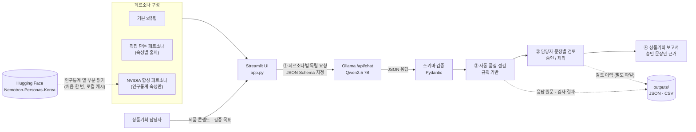
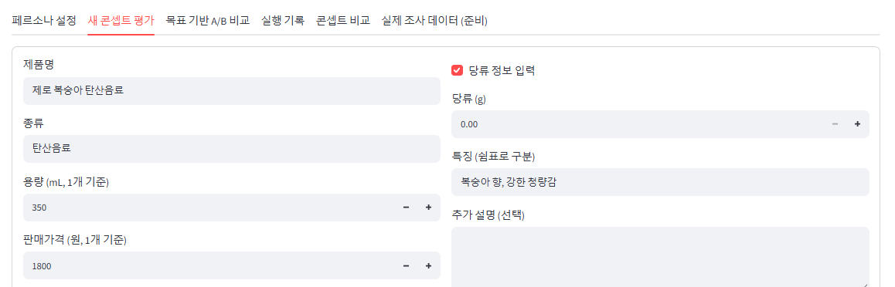
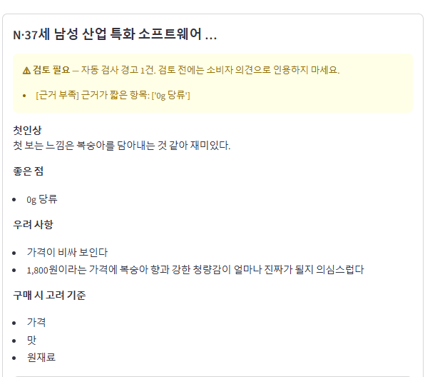
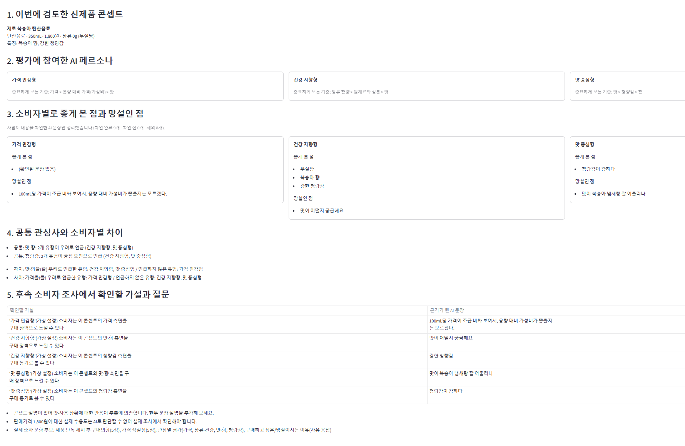

# AI Persona-Based Market Simulation & Response Validation

> 제품 정보와 합성 인구통계 기반 페르소나를 활용해 가상 소비자 의견을 생성하고,
> 자동 품질 점검과 사람의 최종 검토를 거쳐 상품기획 보고서로 제공하는 서비스


> [!IMPORTANT]
> 이 서비스가 보여 주는 소비자 의견은 **모두 AI가 가상 조건으로 생성한 문장**입니다.
> 실제 소비자 반응이 아니며, 구매율, 판매량, 실제 시장 선호도를 측정하거나 예측하지 않습니다.
> 결과물은 실제 소비자 조사에서 확인할 **쟁점·가설·질문 후보**를 정리하는 데 씁니다.

---

## 목차

1. [Project Overview](#project-overview): 문제 정의와 해결 방법
2. [Key Features](#key-features): 각 기능이 해결하는 문제
3. [System Architecture](#system-architecture): 구조와 구성요소별 역할
4. [Tech Stack](#tech-stack)
5. [Demo & Screenshots](#demo--screenshots): 실제 구현 화면
6. [Validation Workflow](#validation-workflow): 검증 절차와 결과
7. [Limitations & Future Work](#limitations--future-work)
8. [Installation & Usage](#installation--usage)
9. [Data Sources & Acknowledgments](#data-sources--acknowledgments)

---

## Project Overview

**LOTTE AX CHALLENGE** 참가 과제로 개발한 음료 신제품 콘셉트 검토용 MVP입니다. 기업의 실제 고객·판매 데이터는 사용하지 않았으며, 서비스의 입력·출력은 가상 콘셉트와 합성 페르소나를 바탕으로 합니다.

> **핵심 논지**
>
> 1. **제품 조사 부담:** 실제 소비자 조사는 비용과 시간이 커서 초기 콘셉트마다 하기 어렵습니다.
> 2. **AI 페르소나 신뢰성 문제:** AI 페르소나는 빠르지만, 그 의견을 그대로 믿기 어렵습니다.
> 3. **자동 점검 + 사람 검토:** 그래서 자동 품질 점검과 담당자의 문장별 승인·제외로 걸러 냅니다.
> 4. **상품기획 활용:** 승인된 문장을 토대로 상품기획 보고서와 실제 조사 질문 후보를 구성합니다.

### 문제 정의

| # | 문제 | 내용 |
|---|---|---|
| 1 | 초기 콘셉트를 소비자 관점에서 점검하기 어려움 | 기획 초기에는 콘셉트 후보가 많습니다. 설문이나 FGI 같은 실제 소비자 조사는 비용과 시간이 커서 모든 후보에 적용하기 어렵습니다. |
| 2 | LLM이 만든 소비자 의견은 그대로 믿기 어려움 | LLM은 그럴듯한 소비자 의견을 쉽게 만듭니다. 하지만 입력에 없는 제품 특징을 지어내거나, 근거 없이 건강 효과를 단정하거나, 소비자가 아닌 판매자 관점으로 쓰는 경우가 있습니다. 점수형 평가는 가격·당류 조건을 바꿔도 거의 바뀌지 않았습니다([설계 근거](#설계-근거-개발-중-관찰)). |
| 3 | 생성 문장을 기획 근거로 쓰려면 검증 이력이 필요함 | 어떤 문장을 승인하거나 제외했는지 검토 이력을 추적할 수 없으면, 보고서에 활용된 근거를 확인하기 어렵습니다. |

### 해결 방법

생성 → 자동 점검 → 사람 검토 → 보고서의 4단계로 처리합니다. **담당자가 승인한 문장만** 상품기획 보고서의 근거로 사용합니다. 이는 실제 소비자 반응의 검증을 의미하지 않습니다.

| 단계 | 방법 | 해결하는 문제 |
|---|---|---|
| ① 가상 소비자 의견 생성 | 서로 다른 조건의 AI 페르소나가 제품 콘셉트에 대해 첫인상, 좋은 점, 우려 사항, 구매 기준을 각자 답합니다. 점수는 묻지 않습니다. | 1 |
| ② 자동 품질 점검 | JSON 스키마 검증과 규칙 기반 검사로 입력 불일치, 모순, 근거 부족, 관점 이탈 같은 문제를 찾아 **'검토 필요'와 사유**를 표시합니다. | 2 |
| ③ 담당자 문장별 승인·제외 | 담당자가 문장마다 승인 또는 제외를 정합니다. 결정 이력은 원본과 따로 저장하며, 자동 승인은 없습니다. | 2, 3 |
| ④ 상품기획 보고서 | **승인된 문장만** 근거로 긍정 요인, 구매 장벽, 공통 쟁점, 검증할 가설, 후속 조사 질문을 정리합니다. 실제 조사 설계와 기획 회의에서 검토할 자료로 제공합니다([활용 방식](#상품기획-활용-방식)). | 1, 3 |

### 차별점: 생성보다 검증에 무게

- **자동 품질 점검:** LLM 응답을 고치거나 버리지 않습니다. 원문은 그대로 보존하고, 문제 유형과 근거 문장을 표시해 담당자가 무엇을 확인해야 하는지 알려 줍니다.
- **담당자 문장별 승인·제외:** 응답 전체가 아니라 문장 단위로 판단합니다. 보고서에는 사람이 승인한 문장만 들어갑니다. 자동 검사를 통과했다는 것만으로는 근거가 되지 않습니다.
- **출처 추적:** 페르소나 속성마다 출처(사용자 입력 / 가상 시나리오 가정 / 실제 조사 근거 / NVIDIA 합성 데이터)를 기록합니다. 실행 기록에는 프롬프트, 모델 옵션, 응답 원문을 함께 저장합니다.

### 상품기획 활용 방식

| 활용 시점 | 활용 방법 |
|---|---|
| 실제 조사 전 콘셉트 검토 | 콘셉트별로 소비자 유형이 긍정·우려로 언급할 수 있는 쟁점을 미리 정리합니다. |
| 조사 설계 | 보고서의 '검증할 가설'과 '실제 조사 문항 후보'를 설문·FGI 문항 초안으로 씁니다. |
| 기획 회의 | PPT 시연 모드로 승인된 문장 중심의 결과를 공유합니다. 품질 검토 상세는 필요할 때 펼쳐 봅니다. |

모든 결과는 실제 조사로 확인하기 전의 **가설과 질문 후보**입니다. 출시 여부나 제품 간 우열을 판단하는 근거로 쓰지 않습니다.

### 서비스 범위

| 이 서비스가 하는 일 | 이 서비스가 하지 않는 일 |
|---|---|
| 콘셉트별 가상 소비자 의견(정성)을 생성합니다. | 실제 소비자 반응을 수집하거나 대체하지 않습니다. |
| 생성 결과의 품질 문제를 표시하고, 담당자의 검토 결과를 기록합니다. | 구매의향 점수, 구매율, 판매량, 시장 선호도를 산출하거나 예측하지 않습니다. |
| 승인된 문장으로 쟁점·가설·조사 질문 후보를 정리합니다. | 제품 간 우열이나 순위를 판정하지 않고, 출시를 추천하지 않습니다. |

---

## Key Features

| 해결하려는 문제 | 기능 | 상태 |
|---|---|---|
| 페르소나 설정이 어디에 근거했는지 알 수 없음 | **근거가 기록되는 페르소나 구성**: 기본 3유형, 직접 만들기(속성별 출처), NVIDIA 합성 페르소나 불러오기 | ✅ 구현 (NVIDIA는 앱에 '실험' 표시) |
| 응답자끼리 서로 영향을 주거나, 형식이 깨진 응답이 섞임 | **페르소나별 독립 생성 + 구조화 출력** | ✅ 구현 |
| 그럴듯하지만 틀린 문장을 사람이 일일이 찾아야 함 | ⭐ **자동 품질 점검**: 문제 유형 분류와 '검토 필요' 사유 표시 | ✅ 구현 |
| 검증되지 않은 문장이 기획 문서에 들어감 | ⭐ **담당자 문장별 승인·제외**: 결정 이력을 따로 저장 | ✅ 구현 |
| AI 의견을 기획 언어로 정리하는 데 시간이 걸림 | **승인 문장 기반 상품기획 보고서**와 CSV 내보내기 | ✅ 구현 |
| 두 콘셉트 비교가 AI의 '선택'에 의존함 | **목표 기반 A/B 비교**: 독립 평가와 규칙 기반 결론 | ✅ 구현 |
| 실제 조사 데이터와 연결할 형식이 없음 | **실제 조사 데이터 탭**: 입력 템플릿과 CSV 형식 검증 | 🟡 준비 단계 |
| AI 의견이 실제 소비자 반응을 얼마나 재현하는지 모름 | 실측 데이터 비교·보정·재현 성능 검증 | ⬜ [향후 계획](#future-work-미구현-계획) |

### 1. 근거가 기록되는 페르소나 구성

- **기본 3유형** (`data/personas_v2.json`)
  - 가격 민감형, 건강 지향형, 맛 중심형입니다.
  - 각 유형은 구매 기준 우선순위 3개와 구매 습관으로 정의한 가상 조건입니다.
- **직접 만들기**
  - 13개 속성을 입력합니다: 연령대, 성별, 직업·생활, 구매 상황, 구매 빈도, 가격 허용 범위, 선호 음료 유형, 맛·향 선호, 당류 고려 수준, 신제품 수용도, 주요 구매 기준, 망설이는 요인, 구매 습관.
  - 속성마다 출처를 고릅니다. '실제 조사 근거'를 고르면 근거(조사명·일자 등) 입력이 필수입니다.
- **NVIDIA 합성 페르소나 불러오기** (앱에 '실험'으로 표시)

| 구분 | 내용 |
|---|---|
| 구현됨 | 연령·성별·지역(시도)·직업 조건으로 [Nemotron-Personas-Korea](https://huggingface.co/datasets/nvidia/Nemotron-Personas-Korea)에서 최대 3명을 선별합니다. 연령대×성별 칸에 데이터셋 내 분포 비례로 배분하고, seed 해시 정렬로 같은 조건이면 같은 결과를 냅니다. 선별한 프로필은 페르소나로 등록되고, 일반 페르소나와 같은 평가 흐름에 들어갑니다. |
| 데이터 사용 범위 | 인구통계 열만 원격으로 일부 읽습니다(9개 파일에서 약 9MB, 로컬 캐시). 연령대, 성별, 직업·지역·가구·주거 형태만 페르소나 속성으로 변환합니다. 데이터에서 온 속성은 `🧬 NVIDIA 합성 데이터`로 표시합니다. |
| 하지 않는 것 | 음료 취향, 구매 빈도, 가격 허용 범위는 데이터에 없어서 비워 둡니다. 필요하면 사용자가 `💭 가상 시나리오 가정`으로 따로 입력합니다. LLM이 생성한 서사 텍스트는 쓰지 않습니다. 공식 통계 기준 가중치 보정은 하지 않습니다. |
| 해석 | 공개 통계 분포를 바탕으로 만든 합성 프로필입니다. 실제 소비자나 대표 표본이 아니고, 이 데이터를 쓴다고 응답이 실제 소비자 반응에 가까워진다는 검증도 하지 않았습니다. |

### 2. 페르소나별 독립 생성과 구조화 출력

- 선택한 페르소나마다 LLM을 따로 호출합니다. 대화 이력을 공유하지 않아, 앞 응답이 뒤 응답에 영향을 주지 않습니다.
- Ollama에 JSON Schema를 지정해 `첫인상 / 좋은 점(1~3) / 우려 사항(1~3) / 구매 기준(1~3)` 구조로 받습니다.
- 응답을 Pydantic으로 다시 검증합니다. 한자·가나는 출력 단계에서 막습니다.
- 100mL당 환산가는 코드에서 계산해 프롬프트에 판매가와 따로 표기합니다. 가격을 혼동하지 않게 하기 위해서입니다.

### 3. ⭐ 자동 품질 점검

모든 응답에 규칙 기반 검사를 적용해 상태와 사유를 표시합니다. 상세한 분류는 [Validation Workflow](#validation-workflow)에 있습니다.

- **응답 단위 상태:** `자동 검사 통과 (의미 정합성 미보장)` / `검토 필요` + 사유 / `검토 필요 (스키마 실패)` / `생성 실패`
- **문장 단위 표시:** `왜곡 의심` / `의미·형식 경고` / `건강 효과 단정` / `설명 부족 (입력과 일치)` / `설명 부족` / `경고 없음`
- **원문 보존:** 응답을 수정하지 않습니다. 저장된 기록도 화면에 표시할 때 현재 검사 기준으로 다시 검사합니다.

### 4. ⭐ 담당자 문장별 승인·제외

- 첫인상, 좋은 점, 우려 사항의 각 문장에 `승인` / `제외` / `검토 전` 중 하나를 정합니다. 기본값은 `검토 전`입니다.
- '승인'은 문장이 입력한 제품 정보와 맞는지 담당자가 확인했다는 뜻입니다. 실제 소비자 의견이라는 뜻이 아닙니다.
- 검토 결과는 원본 실행 기록과 별도 파일에 저장합니다.
  - 문장 원문을 함께 저장해 두고, 원문이 달라지면 그 검토는 적용하지 않습니다.
  - 원본 실행 파일의 sha256도 함께 기록합니다.

### 5. 승인 문장 기반 상품기획 보고서

- **구성:** 콘셉트 요약 → 소비자 유형별로 좋게 본 점과 망설인 점 → 공통 쟁점 → 유형 간 반응 차이 → 검증할 가설(미검증) → 다음 단계(실제 조사 질문 후보)
- **근거:** 승인된 문장만 씁니다. 승인 문장이 없는 유형은 '분석 제외'로 사유와 함께 표시합니다. 근거가 있는 유형이 2개 미만이면 유형 간 비교를 하지 않습니다.
- **함께 표시하는 정보:** 시뮬레이션 품질 정보(경고 집계, 반복 변동성과 제시 순서 편향 주의사항)
- **PPT 시연 모드:** 보고서 중심으로 간결하게 보여 줍니다. 데이터와 계산은 같습니다.

### 6. 목표 기반 A/B 비교

- 검증 목표(상품기획 질문, 확인할 관점, 판단 기준)와 가상 타깃을 설정합니다. 두 제품의 조건 차이 표는 자동으로 만듭니다.
- 페르소나 유형 × 제품마다 **독립 평가**합니다. 한 응답자에게 두 제품을 함께 보여 주고 고르게 하지 않습니다([설계 근거](#설계-근거-개발-중-관찰)).
- 결론은 규칙 기반이며 LLM을 호출하지 않습니다. 다섯 섹션으로 구성됩니다.
  1. 상품기획 질문
  2. 조건 기반 우선 검증 후보: 판단 기준과 제품 조건만 사용
  3. AI 평가 결과의 신뢰 상태
  4. 실제 소비자 선호·판매 판단: **항상 '판단 불가'로 표시**
  5. 후속 실제 조사 질문

### 7. 기타

- **실행 기록·콘셉트 비교:** 저장된 기록을 다시 열어 보고, 여러 콘셉트의 결과를 나란히 봅니다. 콘셉트 사이의 점수나 우열은 표시하지 않습니다.
- **실제 조사 데이터 (준비):** 빈 입력 템플릿을 내려받고, 업로드한 CSV의 형식만 검증합니다. 데이터는 저장하지 않습니다. 형식은 [`docs/survey_data_spec.md`](docs/survey_data_spec.md)에 있습니다.

---

## System Architecture

<!--
  [화면 1] 전체 시스템 구조도 — 이미지를 docs/images/01_system_architecture.png 로 추가한 뒤, 아래 이미지 줄을 이 주석 밖으로 옮기세요.
  
-->



### 구성요소별 역할

| 구성요소 | 이 프로젝트에서 맡은 역할 | 맡지 않는 역할 |
|---|---|---|
| **Python** (`src/`) | 프롬프트 구성, Ollama 호출, 스키마 검증, 규칙 기반 품질 점검, 문장 검토 저장, 보고서·A/B 결론 생성, 결과 저장 | – |
| **Streamlit** (`app.py`) | 입력 폼, 페르소나 관리, 결과 표·카드, 문장별 승인·제외 UI, 시연 모드, CSV 다운로드 | 품질 판정, 보고서·결론 생성 (`src/` 모듈이 담당) |
| **Ollama** | LLM 추론 서버. HTTP `/api/chat`과 JSON Schema 기반 구조화 출력을 제공합니다. | 모델 학습·미세조정 |
| **Qwen2.5 7B** | 페르소나 조건과 제품 정보를 받아 가상 소비자 의견 문장을 생성합니다. **가상 소비자 의견을 만드는 유일한 구성요소**입니다. | 품질 판정, 보고서 작성, 결론 도출 (모두 규칙 기반 코드가 담당) |
| **NVIDIA Nemotron-Personas-Korea** | 합성 페르소나의 인구통계 속성(연령대·성별·직업·지역·가구·주거) 출처 | 응답 생성, 음료 취향 정보, 실제 소비자 반응 근거 |

### 디렉터리 구조

```
.
├── app.py                         # Streamlit 앱 (6개 탭, 사이드바 상태·시연 모드)
├── src/
│   ├── qualitative_feedback.py    # 생성 엔진: 프롬프트, Ollama 호출, 응답 스키마, 자동 품질 점검, 저장·CSV
│   ├── persona_profiles.py        # 구조화 페르소나 (13개 속성·출처), 사용자 페르소나용 프롬프트
│   ├── sentence_review.py         # 문장 단위 자동 표시, 승인·제외 저장
│   ├── planning_report.py         # 상품기획 보고서, 시뮬레이션 품질 정보 (규칙 기반)
│   ├── ab_comparison.py           # 목표 기반 A/B 비교: 프롬프트, 조건 차이, 규칙 기반 결론
│   ├── survey_data.py             # 실제 조사 데이터 템플릿, CSV 형식 검증 (준비 단계)
│   └── runtime_config.py          # 환경변수 설정 (OLLAMA_HOST, APP_OUTPUT_DIR)
├── experiments/nemotron_personas/ # NVIDIA 합성 페르소나 연결 (앱에서 '실험' 기능으로 표시)
│   ├── nemotron_source.py         # Hugging Face parquet 원격 부분 읽기, 캐시
│   ├── selection.py               # 조건 필터, 연령대×성별 비례 배분, seed 해시 정렬
│   └── adapter.py                 # Nemotron 레코드 → 구조화 페르소나 변환
├── data/
│   ├── personas_v2.json           # 기본 가상 소비자 3유형
│   └── examples/product_concepts.json  # 입력 예시용 가상 제품 콘셉트
├── examples/sample_outputs/       # 샘플 실행 기록 1건 (outputs/ 와 같은 폴더 구조)
│   ├── runs/20261104_023549_56a74f.json     # AI 가상 의견 생성 기록 (프롬프트, 응답 원문 포함)
│   └── reviews/20261104_023549_56a74f.json  # 담당자 문장별 승인·제외 기록
├── docs/
│   ├── images/                    # README 스크린샷
│   ├── survey_data_spec.md        # 실제 조사 데이터 입력 명세
│   └── CHANGES_FROM_ORIGINAL.md   # 개발 환경 원본 코드와 공개본의 차이
├── .streamlit/config.toml         # 127.0.0.1 바인딩, 사용 통계 전송 끔
├── .gitattributes                  # 샘플 JSON의 Git 줄바꿈 자동 변환 방지
├── .gitignore                      # 결과 파일·가상환경·캐시 제외
├── requirements.txt
├── NOTICE.md                      # 데이터·모델·소프트웨어 출처와 라이선스
└── outputs/                       # (실행 시 자동 생성, Git 제외) 평가 기록, 검토 결과, 페르소나, 캐시
```

---

## Tech Stack

| 구분 | 사용 기술 | 비고 |
|---|---|---|
| Language | Python 3.10+ | 개발·오프라인 검증: Python 3.10 |
| Web UI | Streamlit 1.65 | |
| LLM Runtime | Ollama | HTTP `/api/chat`, `format` = JSON Schema |
| LLM | Qwen2.5 7B Instruct (`qwen2.5:7b`, 4-bit Q4_K_M) | temperature 0.7, 응답 최대 768 토큰 |
| Validation | Pydantic v2, 정규식 기반 규칙 검사 | |
| Persona Data | NVIDIA Nemotron-Personas-Korea (CC BY 4.0) | pyarrow, huggingface_hub로 원격 부분 읽기 |
| Storage | 로컬 JSON / CSV | |

- **개발·검증 환경:** Ubuntu 24.04, NVIDIA RTX 3080 10GB
- **자원 사용:** 모델을 적재하면 VRAM 약 5GB를 씁니다.
- **생성 속도:** 응답 1건에 약 1~4초가 걸렸습니다(저장된 55건 기준).

---

## Demo & Screenshots

아래는 구현된 Streamlit 화면의 기능별 설명입니다. **스크린샷은 아직 첨부되지 않았습니다.** 저장소의 샘플 실행 기록을 불러오면 가상 소비자 응답, 검토 이력, 보고서를 앱에서 확인할 수 있습니다([샘플 결과 확인](#샘플-결과-확인-ollama-없이-가능)).

<!--
  스크린샷 추가 방법: docs/images/ 에 아래 파일명으로 이미지를 넣은 뒤, 각 화면 설명 아래 이미지 줄의 주석 기호를 지우세요.
  주석 상태에서는 GitHub에 이미지가 표시되지 않으므로 깨진 이미지도 나타나지 않습니다.
-->

**화면 2. 제품 입력 및 페르소나 선택**
제품명, 용량, 판매가격, 당류, 특징을 입력하고, 기본 3유형과 직접 만든·불러온 페르소나 중 평가할 대상을 고릅니다.
<!--  -->

**화면 3. AI 소비자 반응 생성**
페르소나별로 독립 생성된 첫인상, 좋은 점, 우려 사항, 구매 기준을 요약 표와 상세 카드로 보여 줍니다. 모든 의견에 `AI 생성 가상 의견 · 실측 미검증`이 표시됩니다.
<!--  -->

**화면 4. 자동 품질 점검과 문장별 승인·제외**
응답마다 검토 상태와 사유를, 문장마다 자동 표시를 보여 줍니다. 담당자는 문장별로 승인 또는 제외를 정합니다.
<!--  -->

**화면 5. 승인된 의견을 활용한 상품기획 보고서**
승인된 문장만 근거로 긍정 요인, 구매 장벽, 공통 쟁점, 검증할 가설, 후속 조사 질문을 정리합니다.
<!--  -->

**화면 6. 소비자 유형별 반응 비교 결과**
소비자 유형별로 좋게 본 점과 망설인 점, 유형 간 반응 차이를 나란히 보여 줍니다. 순위나 우열은 표시하지 않습니다.
<!--  -->

---

## Validation Workflow

생성된 문장을 바로 결론으로 쓰지 않습니다. 아래 단계를 거쳐 **담당자가 승인한 문장만** 보고서 근거로 씁니다.

```
LLM 생성 ─▶ 스키마 검증 ─▶ 자동 품질 점검 ─▶ 담당자 문장별 승인·제외 ─▶ 보고서 (승인 문장만)
```

### 1. 생성 단계의 제약

- 페르소나마다 독립 호출합니다. 대화 이력을 공유하지 않습니다.
- JSON Schema로 응답 구조를 강제합니다. 한자·가나는 출력 문자 패턴으로 차단합니다.
- 점수형 문항(구매의향 점수 등)은 묻지 않습니다.
- 응답 원문은 수정하지 않고 프롬프트, 모델 옵션, Ollama 메타데이터와 함께 저장합니다.

### 2. 스키마 검증 (Pydantic)

필드, 항목 수, 길이, 허용 문자를 검사합니다.

| 상태 | 조건 |
|---|---|
| `검토 필요 (스키마 실패)` | 원문은 있지만 스키마를 통과하지 못함 |
| `생성 실패` | 원문 자체가 없음 |

### 3. 자동 품질 점검 (규칙 기반)

| 분류 | 검사 내용 (예) |
|---|---|
| `[입력 불일치]` | 입력과 다른 수치, 당류 정보와 어긋나는 서술(예: 무설탕 제품인데 '당이 많다'), 입력에 없는 특징 언급, 특징 강도를 다른 속성에 붙인 왜곡(예: '강한 청량감' → '복숭아 향이 강한'), 100mL당 환산가를 판매가처럼 서술 |
| `[모순]` | 좋은 점과 우려가 거의 같음, 우려 사항에 긍정 서술만 있음, 같은 가격·당류를 좋은 점과 우려로 동시에 평가 |
| `[근거 부족]` | 이유 없이 짧은 항목 |
| `[건강 효과 단정]` | 입력값만으로 건강 효과를 단정. 단정이 아닌 추측(`[건강 효과 추론]`)은 검토 메모로만 표시 |
| `[역할 혼동]` | 구매 기준 항목에 제품 감상이 들어가거나, 좋은 점 내용을 반복 |
| `[관점]` | 응답자 본인이 아니라 3인칭·일반론이나 판매자·마케터 관점으로 서술. A/B 비교에서는 연령·성별을 근거로 한 판단도 표시 |
| `[문체]`, `[언어]`, `[형식]` | 반말 의문형, 한국어 비율 낮음·입력에 없는 영문 표현, 항목 중복·깨진 문자열 |

- 검사 결과는 '검토 필요' 표시에만 씁니다. 응답을 고치거나 버리지 않습니다.
- 자동 검사는 의미 정합성을 보장하지 않습니다. 그래서 통과 상태에도 `의미 정합성 미보장`을 함께 표시하고, 최종 판단은 담당자에게 맡깁니다.

### 4. 담당자 문장별 승인·제외 → 보고서

- 기본값은 `검토 전`이고, 자동 승인은 없습니다.
- 보고서에는 승인 문장만 들어갑니다. 검토 이력은 원본과 따로 저장합니다.
- 가설은 모두 `미검증`으로 표시하고, 실제 조사 질문 후보로 연결합니다.
- 제품 순위, 추천, 판매 예측은 만들지 않습니다.

### 검증 결과

#### 샘플 사례: 가상 의견 생성 → 자동 점검 → 문장별 승인·제외 → 보고서

저장소에 포함된 샘플 기록([`examples/sample_outputs/`](examples/sample_outputs/))으로 전체 흐름을 볼 수 있습니다. 개발 환경에서 실제로 생성하고 검토한 기록을 수정하지 않고 그대로 넣었습니다. 확인 방법은 [샘플 결과 확인](#샘플-결과-확인-ollama-없이-가능)에 있습니다.

> 아래 인용 문장은 모두 **AI가 생성한 가상 의견**입니다. 실제 소비자 반응이 아닙니다.

**입력**

- 콘셉트(가상): 제로 복숭아 탄산음료 — 탄산음료, 350mL, 1,800원(100mL당 514원), 당류 0g, 특징 '복숭아 향', '강한 청량감'
- 페르소나: 기본 3유형(가격 민감형, 건강 지향형, 맛 중심형)

**① 가상 소비자 의견 생성**

3개 응답이 모두 스키마를 통과했습니다. 응답 1건 생성에 약 1~4초가 걸렸습니다.

**② 자동 품질 점검**

3개 응답 모두 `검토 필요`로 표시되었습니다.

| 소비자 유형 | 표시된 사유 |
|---|---|
| 가격 민감형 | 입력에 없는 특징 강도 서술("복숭아 향이 강한데…"), 3인칭·일반론 서술 가능성 |
| 건강 지향형 | 입력에 없는 특징 강도 서술(첫인상), 근거가 짧은 항목('무설탕', '복숭아 향', '강한 청량감') |
| 맛 중심형 | 입력에 없는 특징 강도 서술("복숭아 향이 강하다"), 근거가 짧은 항목('비싸다') |

**③ 담당자 문장별 승인·제외**

17개 문장 중 **승인 9개, 제외 8개**로 결정했습니다. 일부 문장은 다음과 같습니다.

| 문장 (AI 생성) | 자동 표시 | 담당자 결정 | 입력 정보와 비교 |
|---|---|---|---|
| 100mL당 가격이 조금 비싸 보여서, 용량 대비 가성비가 좋을지는 모르겠다. | 경고 없음 | 승인 | 입력과 어긋나지 않음 |
| 무설탕 | 설명 부족 (입력과 일치) | 승인 | 짧지만 입력과 일치 |
| 복숭아 향이 강하다 | 왜곡 의심 | 제외 | 입력에서 '강한'은 청량감의 수식어 |
| 복숭아 향이 강한 탄산음료라 복숭아 맛이 궁금해 보이네요. | 경고 없음 | 제외 | 위와 같은 강도 왜곡이지만, 자동 검사가 표시하지 못함 |
| 당이 없으니 건강에 좋을 것 같아 | 경고 없음 | 제외 | 입력에 없는 건강 효과 추측 |
| 무설탕이고 복숭아 향이 강한 청량감을 주는 탄산음료라 흥미로웠습니다. | 왜곡 의심 | 승인 | 자동 검사는 강도 왜곡으로 표시했지만 담당자는 승인 |

**④ 상품기획 보고서 (승인 문장만 근거)**

- **공통 쟁점**
  - 맛·향: 2개 유형(건강 지향형, 맛 중심형)이 우려로 언급
  - 청량감: 2개 유형이 긍정 요인으로 언급
- **유형 간 차이:** 가격은 가격 민감형만 우려로 언급
- **검증할 가설:** 5개, 모두 `AI 도출 · 사람이 문장 정합성 승인 · 실제 소비자 검증 전`
  - 예: "'가격 민감형'(가상 설정) 소비자는 이 콘셉트의 가격 측면을 구매 장벽으로 느낄 수 있다"
- **다음 단계**
  - "판매가격 1,800원에 대한 실제 수용도는 AI로 판단할 수 없어 실제 조사에서 확인해야 합니다."
  - 실제 조사 문항 후보: 구매의향 5점, 가격 적절성 5점, 관점별 평가, 자유 응답
- 제품 순위나 추천은 만들지 않았습니다.

**상품기획 활용**

이 결과는 소비자 반응을 예측한 것이 아닙니다. 실제 조사에서 먼저 확인할 쟁점(가격 수용도, 맛과 향의 조화)과 문항 후보를 정리한 것입니다.

**이 사례에서 확인한 점**

- 자동 표시와 담당자 결정이 다른 문장이 있었습니다.
  - `경고 없음`이었지만 제외: 4개 (특징 강도 왜곡 2개, 건강 효과 추측 2개)
  - `왜곡 의심`이었지만 승인: 1개
- 자동 점검은 담당자가 우선 확인할 곳을 알려 주는 도구이고, 무엇을 보고서 근거로 쓸지는 담당자가 정합니다. 서비스는 이 결정 이력을 원본과 분리해 남깁니다.

#### 공개본 동작 확인

LLM과 외부 네트워크 없이 확인한 항목입니다. 개발 환경에 저장된 LLM 응답을 HTTP 단계에서 재생했고, 루프백이 아닌 연결은 모두 차단했습니다.

- 앱 시작과 6개 탭 표시
- 기본 페르소나·NVIDIA 합성 페르소나 평가 경로
- 자동 품질 점검, 문장별 승인·제외 저장, 승인 문장만 반영한 보고서 생성
- A/B 비교 결론, 시연 모드, 조사 CSV 형식 검증
- 공개본이 만든 프롬프트가 개발 환경 원본과 같고, 품질 점검 결과도 같다는 것

#### 설계 근거 (개발 중 관찰)

모두 단일 모델로 한 소규모 내부 점검입니다. 실제 소비자 데이터와 비교한 검증이 아닙니다.

| 관찰 | 설계 결정 |
|---|---|
| 점수형 평가에서 가격(1,200 / 1,800 / 2,800원)이나 당류(0 / 20g)를 바꿔도 점수 변화가 반복 잡음 범위(0~1점) 안이었습니다. 콘셉트 매력도는 36건 모두 같은 점수였습니다. | 점수를 묻지 않고 정성 의견과 검증 절차 중심으로 설계 |
| 한 페르소나에게 두 제품을 함께 보여 주고 고르게 하자, A나 B를 고른 응답 8건이 모두 수동 검토에서 오류(지어낸 취향, 없는 차이 주장)였습니다. 그중 7건이 먼저 제시된 제품을 골랐습니다. | 제품별 독립 평가, 실제 선호 판단은 '판단 불가'로 고정 |
| 같은 조건으로 다시 실행하면 자동 검사 통과 수와 수동 오류 수가 크게 달라졌습니다. | 단일 실행 결과로 결론 내지 않도록 화면에 변동성 주의사항 표시 |
| 외부 다중 에이전트 프레임워크(TinyTroupe)를 연동했을 때 이 모델에서는 한국어 소비자 역할 수행이 잘 되지 않았습니다. | Ollama API를 직접 호출하는 자체 엔진으로 구현 (TinyTroupe 미사용) |

---

## Limitations & Future Work

### Limitations

- **실측 검증 없음:** 생성된 의견이 실제 소비자 반응을 얼마나 재현하는지 검증하지 않았습니다. 페르소나는 특정 인구 집단을 대표하지 않습니다.
- **모델 변동성:** 7B 모델 하나와 temperature 0.7을 써서, 같은 조건에서도 실행마다 응답이 달라집니다.
- **자동 점검의 한계:** 규칙 기반이라 오탐과 미탐이 있습니다. 위 실행 예시처럼 의미 판단은 담당자 검토에 의존합니다.
- **NVIDIA 합성 페르소나의 한계:** 인구통계 속성만 씁니다. 음료 취향과 소비 성향이 없고, 가중치 보정을 하지 않으며, 한 번에 최대 3명까지 선별합니다. 처음 쓸 때는 인터넷 연결이 필요합니다.
- **사용자 정의 페르소나:** 이 경로의 프롬프트는 소규모(응답 20건) 생성으로만 확인했습니다.
- **조사 데이터 기능:** '실제 조사 데이터' 탭은 형식 검증만 합니다.
- **운영 기능 없음:** 단일 사용자 로컬 실행을 전제로 합니다. 인증, 권한, 동시 사용자 처리는 없습니다.

### Future Work (미구현 계획)

아래 항목은 모두 **구현되지 않은 계획**입니다.

| 영역 | 계획 |
|---|---|
| 실제 소비자 데이터 연계 | 기업이 보유한 설문·FGI 응답을 업로드·저장하고, 같은 제품·타깃 조건의 AI 의견과 비교합니다. 판매·POS·리뷰 데이터는 페르소나 속성의 '실제 조사 근거'로 연결합니다. |
| 반응 재현 성능 검증 | 비교 지표와 성공 기준을 미리 고정합니다(자유응답 주제 일치도, 선호 방향 등). 실측 데이터를 보정용과 검증용으로 분리하는데, 응답자 단위와 콘셉트 단위로 나눕니다. 보정 전 기준을 비교한 뒤 보정용 데이터로만 조정하고, 검증용 데이터로 재평가합니다. **검증을 통과한 지표만** 화면에 노출합니다([`docs/survey_data_spec.md`](docs/survey_data_spec.md)). |
| 페르소나 대표성 | 출처와 연도가 있는 공식 통계 기준표로 인구통계 칸별 가중치를 보정합니다. 실제 조사에서 얻은 음료 취향 속성을 결합합니다. |
| 검토 효율 | 검토 이력을 바탕으로 자동 점검 규칙의 오탐·미탐을 개선합니다. 검토자가 여러 명일 때 일치도를 관리합니다. |
| 운영 | 사용자 인증, 프로젝트별 데이터 분리, 사내 서버 배포 |

---

## Installation & Usage

### 요구 사항

- Python 3.10 이상 (개발·검증: 3.10)
- [Ollama](https://ollama.com/download)
- GPU 권장: `qwen2.5:7b` 모델 파일 약 4.7GB, 적재 시 VRAM 약 5GB
- 인터넷 연결이 필요한 경우
  - 패키지와 모델 설치
  - NVIDIA 합성 페르소나 기능을 처음 쓸 때 (Hugging Face 로그인은 필요 없음)
  - 나머지 기능은 설치 후 로컬에서만 동작합니다.

### 1. 설치

```bash
git clone https://github.com/kgh1234/ai-persona-market-simulation.git
cd ai-persona-market-simulation

python3 -m venv .venv
source .venv/bin/activate          # Windows: .venv\Scripts\activate
pip install -r requirements.txt
```

`requirements.txt`는 개발 환경에서 사용한 버전을 기준으로 작성했습니다. 오프라인 동작 확인은 기존 Python 3.10 환경에서 수행했으며, 새 운영체제·새 가상환경에서의 설치와 실제 LLM 호출은 별도 검증이 필요합니다.

### 2. 모델 준비와 Ollama 실행

```bash
ollama pull qwen2.5:7b
ollama serve                        # 데스크톱 앱 등으로 이미 실행 중이면 생략
```

### 3. 앱 실행

```bash
streamlit run app.py
# 브라우저: http://127.0.0.1:8501
```

- Ollama가 기본 주소(`127.0.0.1:11434`)가 아니면 `OLLAMA_HOST`로 지정합니다.

  ```bash
  OLLAMA_HOST=127.0.0.1:11435 ollama serve           # 다른 포트로 Ollama 실행
  OLLAMA_HOST=127.0.0.1:11435 streamlit run app.py
  ```

- 원격 서버에서 실행했다면 SSH 포트 포워딩으로 접속합니다: `ssh -L 8501:127.0.0.1:8501 <user>@<server>`
- 사이드바 '시스템 상태'에서 Ollama 연결 여부와 모델 설치 여부를 확인할 수 있습니다.
- `.streamlit/config.toml`에서 파일 감시를 꺼 두었습니다. 코드를 수정한 뒤에는 앱을 다시 시작하세요.

### 환경 변수

| 변수 | 기본값 | 설명 |
|---|---|---|
| `OLLAMA_HOST` | `http://127.0.0.1:11434` | Ollama 서버 주소. 해석 규칙은 Ollama CLI와 같습니다: scheme이 없으면 기본 포트 11434, `http://`에 포트가 없으면 80, `https://`는 443. |
| `APP_OUTPUT_DIR` | `./outputs` | 실행 중 생성되는 파일을 저장할 폴더. 상대경로는 프로젝트 폴더 기준입니다. |

### 실행 결과 저장 위치

앱이 시작할 때 아래 폴더를 자동으로 만듭니다. `outputs/`는 Git에서 제외됩니다.

```
outputs/
├── runs/          # 새 콘셉트 평가 기록 (프롬프트, 응답 원문, Ollama 메타데이터 포함)
├── ab_runs/       # 목표 기반 A/B 비교 기록
├── reviews/       # 문장별 승인·제외 결과 (원본 기록과 분리)
├── personas/      # 직접 만들거나 불러온 페르소나
└── cache/         # NVIDIA 데이터 인구통계 열 캐시, huggingface_hub 설정
```

### 사용 흐름

1. **페르소나 설정:** 기본 3유형을 확인하고, 필요하면 페르소나를 직접 만들거나 NVIDIA 합성 페르소나를 불러옵니다.
2. **새 콘셉트 평가:** 제품 정보를 입력하고 평가할 페르소나를 고른 뒤 '가상 소비자 의견 생성'을 누릅니다. 입력 예시는 [`data/examples/product_concepts.json`](data/examples/product_concepts.json)에 있습니다.
3. **문장별 검토:** 결과 화면에서 문장마다 승인 또는 제외를 정하고 저장합니다.
4. **상품기획 보고서:** 승인된 문장을 근거로 한 보고서를 확인하고, 필요하면 CSV로 내려받습니다.
5. **목표 기반 A/B 비교:** 두 콘셉트를 같은 목표·타깃 조건에서 독립적으로 평가하고, 규칙 기반 결론을 확인합니다.

### 샘플 결과 확인 (Ollama 없이 가능)

저장소에 포함된 샘플 기록을 결과 폴더로 복사한 뒤 앱을 실행합니다. 샘플 원본은 `examples/`에 그대로 두고 사본을 씁니다.

```bash
mkdir -p outputs
cp -r examples/sample_outputs/. outputs/
streamlit run app.py
```

```powershell
# Windows PowerShell
New-Item -ItemType Directory -Force outputs | Out-Null
Copy-Item -Recurse -Force examples\sample_outputs\* outputs\
streamlit run app.py
```

1. **실행 기록** 탭에서 `제로 복숭아 탄산음료 · 3개 유형` 기록을 고릅니다.
2. 같은 화면에서 다음 내용을 확인합니다.
   - 응답별 자동 점검 상태와 사유
   - 승인된 문장만 반영된 **상품기획 보고서**
   - 저장된 **문장별 검토**(승인 9개, 제외 8개)
3. 사이드바의 **PPT 시연 모드**를 켜면 보고서 중심 화면으로 바뀝니다.

참고 사항

- Ollama가 실행 중이 아니면 사이드바에 연결 오류가 표시됩니다. 저장된 기록을 보는 데는 영향이 없습니다.
- 화면에서 검토를 다시 저장하면 `outputs/`의 사본만 바뀌고, `examples/`의 샘플은 바뀌지 않습니다.
- `APP_OUTPUT_DIR`을 지정했다면 `outputs/` 대신 그 폴더로 복사하세요.
- 샘플 파일은 수정하지 않는 것을 권장합니다. 검토 기록에 실행 기록 파일의 sha256이 함께 저장되어 있습니다.

---

## Data Sources & Acknowledgments

| 구분 | 출처 | 라이선스 | 저장소 포함 여부 |
|---|---|---|---|
| 합성 페르소나 데이터 | [NVIDIA Nemotron-Personas-Korea](https://huggingface.co/datasets/nvidia/Nemotron-Personas-Korea) (rev. `ada0f5b`) | CC BY 4.0 | 미포함 (실행 시 인구통계 열만 원격으로 읽고 로컬에 캐시) |
| 기본 페르소나·예시 콘셉트 | 프로젝트에서 직접 작성한 가상 데이터 | 별도 라이선스 미지정 | 포함 |
| 샘플 실행 기록 (`examples/sample_outputs/`) | 이 프로젝트에서 Qwen2.5 7B로 생성한 가상 의견과 담당자 검토 기록 (기본 3유형만 사용, NVIDIA 데이터 미포함) | 별도 라이선스 미지정 | 포함 |
| LLM | [Qwen2.5 7B Instruct](https://huggingface.co/Qwen/Qwen2.5-7B-Instruct) (Ollama `qwen2.5:7b`) | Apache 2.0 | 미포함 (사용자가 직접 내려받음) |
| LLM 런타임 | [Ollama](https://github.com/ollama/ollama) | MIT | 미포함 |

- **NVIDIA Nemotron-Personas-Korea:** 데이터셋의 일부 레코드를 선별하고, 인구통계 필드를 이 프로젝트의 페르소나 형식으로 변환해 사용합니다. 서사 텍스트는 쓰지 않습니다. 합성 데이터이며 실존 인물이 아닙니다. 인용 정보와 변경 사항은 [NOTICE.md](NOTICE.md)에 있습니다.
- **참고한 외부 프로젝트**
  - [microsoft/TinyTroupe](https://github.com/microsoft/TinyTroupe)는 개발 초기에 별도로 실험한 프레임워크입니다. 최종 서비스에는 사용하지 않았습니다.
  - [Power-xc/power-persona-sim](https://github.com/Power-xc/power-persona-sim)에서는 원격 부분 읽기와 재현 가능한 선별 아이디어만 참고했고, 코드는 포함하지 않았습니다.
- 데이터, 모델, 소프트웨어별 이용 조건과 상표 고지는 [NOTICE.md](NOTICE.md)에 있습니다.
- 공개 저장소의 코드가 개발 환경 원본과 다른 부분은 [docs/CHANGES_FROM_ORIGINAL.md](docs/CHANGES_FROM_ORIGINAL.md)에 정리했습니다.

### License

현재 이 프로젝트 자체에는 별도의 **LICENSE 파일이 없습니다.** 저장소를 공개했다고 해서 소스코드와 샘플 데이터를 자유롭게 수정·재배포할 수 있도록 이용허락한 것은 아닙니다. 공개 권리 관계를 확인한 뒤 라이선스 적용 여부를 결정할 예정입니다. 외부 데이터셋과 모델에는 각각의 별도 라이선스가 적용됩니다.
